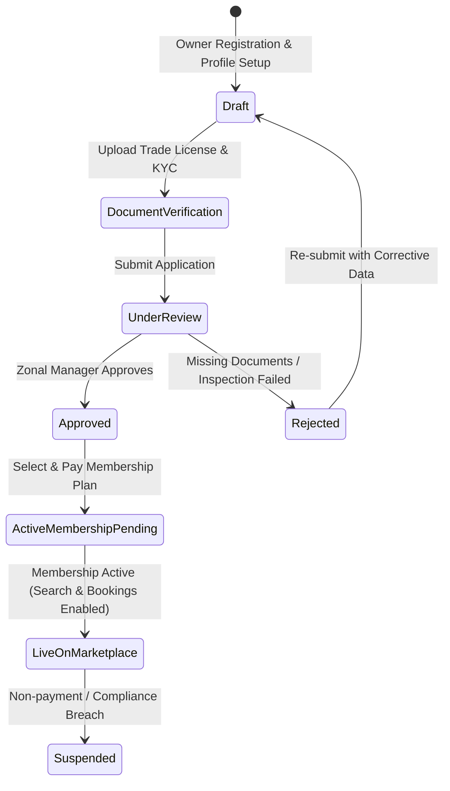
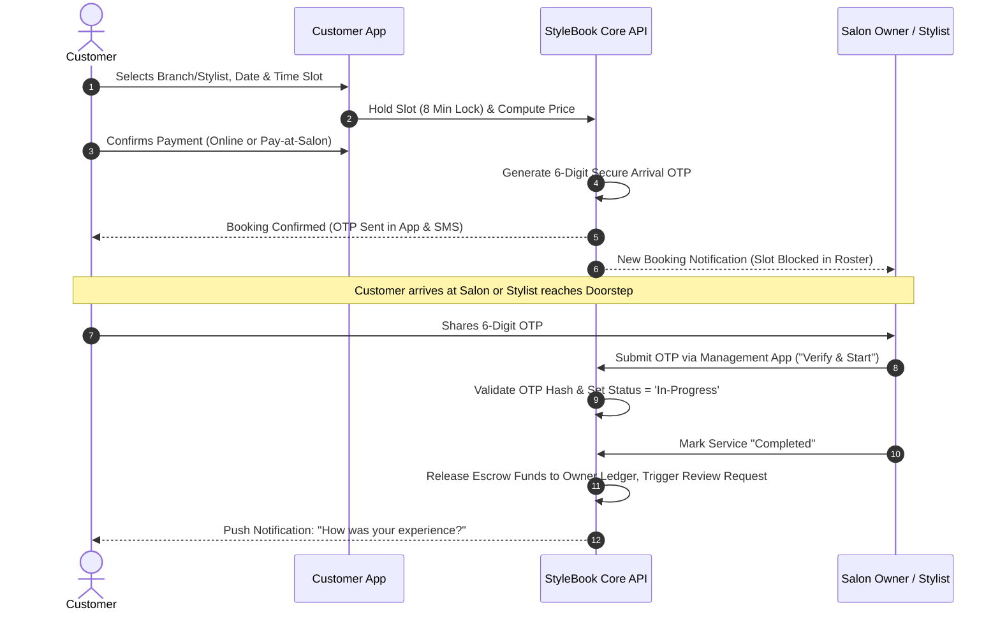
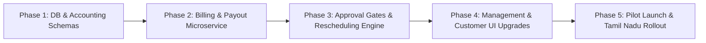

# StyleBook - Comprehensive Business Requirements, Flow Analysis & Accounting Architecture Specification
**Document Version:** 2.0  
**Target Project:** StyleBook Enterprise Salon & On-Demand Grooming Platform  
**Location:** `C:\Users\ayesh\Desktop\Mahathir\Projects\StyleBook`  
**Date:** November 2026  
**Author:** Antigravity Solution Architecture & Financial Systems Design  

---

## 1. Executive Evaluation & Gap Analysis

StyleBook is architected as an enterprise-grade salon management and on-demand grooming platform with microservices (.NET 8, PostgreSQL, Ocelot Gateway, React Management Portal, and Next.js Customer Portal). 

An in-depth review of the current implementation against your core vision reveals strong foundations in geography mapping, booking slot algorithms, and dual ratings. However, **critical gaps exist in commercial monetization, financial accounting, multi-role separation of duties, and state-machine approval lifecycles.**

### Current Implementation vs. Target Vision Matrix

| Dimension | Current Implementation | Target Business Requirement | Gap Status & Priority |
| :--- | :--- | :--- | :--- |
| **Monetization Model** | Standalone appointment booking without billing monetization. | **Dual Revenue Model:** Recurring SaaS Membership + Dynamic Booking Commission take-rate. | **Critical (Missing)** - Requires new Billing & Accounting Domain. |
| **Accounting & Payouts** | Basic booking totals and net payables recorded without ledger. | **Full Double-Entry Accounting:** Escrow holding, platform fee cut, owner wallet, cash trip commission deduction, automated payout cycles. | **Critical (Missing)** - Necessary for real-world operations. |
| **User Separation** | Broad territorial admin hierarchy (SuperAdmin, State, Zone). | **Functional Role Separation:** Explicit roles for Operations Manager, Compliance Admin, and Finance/Accounts Officer with scoped territorial rights. | **High (Requires Extension)** - Management needs segregated duties. |
| **Approval Lifecycle** | Salons have approval status; branches and service edits go live instantly. | **Strict Approval Gates:** Owners, new Branches, and custom Service mappings remain `Draft / Pending_Approval` until Zonal/Admin approves. | **High (Flow Correction)** - Prevent unauthorized or uninspected listings. |
| **Booking Reschedule & Cancel** | Static cancellation reason field in database. | **Dynamic Reschedule & Cancellation Policy Engine:** Penalty windows, refund tiers, wallet reversals, slot release. | **High (Flow Enhancement)** - Essential for customer trust and salon roster stability. |
| **Doorstep Operations** | Flag on branch and stylist with radius. | **Real-time Doorstep Logistics:** Travel allowance pricing, commute buffer time calculation, address geofencing, safety check-ins. | **Medium-High (Refinement)** - Prevent overlapping slots with commute times. |

---

## 2. Multi-Role Hierarchy & Scoped Governance

Instead of a monolithic administrator managing everything, the platform enforces **functional separation of duties** combined with **hierarchical territorial and brand scoping**.

```
                           +----------------------------+
                           |  LEVEL 1: SUPER ADMIN      |
                           |  (Global Platform Master)  |
                           +--------------+-------------+
                                          |
          +-------------------------------+-------------------------------+
          |                               |                               |
+---------v----------+         +----------v---------+         +-----------v----------+
| REGIONAL OPERATIONS |         | REGIONAL FINANCE   |         | REGIONAL MARKETING   |
| (Admins & Managers) |         | & ACCOUNTS OFFICER |         | & COMPLIANCE HEAD    |
+---------+----------+         +----------+---------+         +-----------+----------+
          |                               |                               |
          | Territorial Scope:            | Financial Scope:              | Regulatory Scope:
          | Country -> State -> Zone      | Commission rates, Payouts,    | Hygiene notices,
          | -> District -> Locality       | Invoices, Refunds, Tax (GST)  | Dispute arbitration
          +-------------------------------+-------------------------------+
                                          |
                               +----------v-----------+
                               | LEVEL 4: SALON OWNER |
                               | (Multi-Branch/Solo)  |
                               +----------+-----------+
                                          |
                        +-----------------+-----------------+
                        |                                   |
              +---------v---------+               +---------v---------+
              | BRANCH MANAGERS   |               | STYLISTS/BARBERS  |
              | (Physical Store)  |               | (In-Salon/Mobile) |
              +-------------------+               +-------------------+
```

### 2.1 Management Roles & Functional Scope
1. **Super Admin (Global Master)**:
   - Sets global commission ceilings and base platform parameters.
   - Creates and activates Countries and top-level Currencies.
   - Full visibility across all tenant accounts and financial ledgers.
2. **Operations Admin / Regional Manager**:
   - **Jurisdiction Scopes**: Country, State, Zone, or District.
   - Evaluates owner onboarding requests, verifies trade licenses and identity documents.
   - Inspects and approves newly registered branches and branch service catalogs.
   - Manages territorial compliance, operational notices, and salon suspensions.
3. **Finance & Accounts Officer**:
   - Manages Owner Membership Subscription tiers (pricing, perks, limits).
   - Configures booking commission rates (per-category, per-zone, or per-owner tier).
   - Audits weekly/monthly automated payout batches.
   - Reconciles payment gateway deposits with bank payouts, processes disputed refunds, and generates B2B GST tax invoices.
4. **Brand Manager (Enterprise Scope)**:
   - Assigned to specific multi-branch enterprise salon chains (e.g., Naturals, Green Trends).
   - Oversees quality metrics, cross-branch promotions, and brand-wide stylist transfers.

### 2.2 Scoped Communication & Announcements Engine
Management can broadcast notices and promotional offers with strict target filtering:
- **Audience Types:** `CUSTOMER`, `OWNER`, `STYLIST`, `BRANCH_POC`.
- **Targeting Filters:**
  - By Geography: Global, Country, State, Zone, District, or Specific Locality.
  - By Commercial Tier: Free-tier Owners vs. Gold/Platinum Subscribers.
  - By Performance: Salons with ratings below 3.5 stars (warning notice).
- **Enforcement Levels:**
  - `INFORMATIONAL`: Banner on dashboard / home screen.
  - `CRITICAL_ACTION_REQUIRED`: Blocks dashboard actions until the owner acknowledges or uploads required compliance documents within the grace period (e.g., 48 hours).

---

## 3. Owner Onboarding, Branching & Approval Workflows

### 3.1 Owner Business Types
1. **Chain Salon Enterprise:** Single registered entity owning multiple physical salon branches across districts.
2. **Independent Standalone Salon:** Single boutique salon operating at one physical location.
3. **Independent Solo Beautician / Mobile Barber:** Professional without a commercial storefront, serving customers exclusively via Doorstep / Home Studio.

### 3.2 End-to-End Onboarding & Approval State Machine



### 3.3 Branch Creation & Stylist Mapping Workflow
1. **Branch Definition**:
   - Address, GPS coordinates (latitude/longitude), contact details, branch POC.
   - Operational mode: In-Salon Only, Doorstep Only, or Hybrid (Both In-Salon and Doorstep).
   - *Status starts at `Pending_Approval`*. Zonal Manager inspects the locality, confirms parking/hygiene parameters, and approves.
2. **Service Mapping & Custom Pricing**:
   - Owner selects services from the Master Service Catalog (Haircut, Keratin, Facial, etc.).
   - Sets custom price within platform boundary constraints:
     $$\text{Custom Price} \ge \text{Regional Minimum Floor Price}$$
   - Can designate services as "Negotiable" with a minimum counter-offer threshold.
3. **Stylist Roster & Skill Set Association**:
   - Owner adds stylists and binds them to one or more branches.
   - Multi-selects services certified for each stylist.
   - Defines standard weekly shifts (Monday to Sunday timings with break hours) and customized service durations (e.g., Stylist A takes 30 mins for Haircut, Stylist B takes 45 mins).
   - Doorstep capability toggle with operational radius (e.g., up to 10 km from branch).

---

## 4. End-to-End Customer Booking Flow & Integrity Rules

### 4.1 The Two Entry Points & Relational Validation
To ensure that a booking never fails due to mismatched capabilities or unavailable equipment, StyleBook enforces a strict relational integrity matrix:

```
[Entry Point A: Branch-First]
Customer picks Branch (B)
   --> Only services offered at (B) are shown.
   --> Only stylists stationed at (B) who can perform the selected service are shown (+ "Any Available Stylist").

[Entry Point B: Stylist-First]
Customer picks Stylist (T)
   --> Only services certified for (T) are shown.
   --> Only branches where (T) operates are shown (+ Doorstep if enabled).
```

### 4.2 Dynamic Slot Reservation & Concurrency Control
- **Atomic Temporary Hold (Cart Lock)**: When a customer enters the checkout screen, the requested slot is temporarily reserved for **8 minutes** using a Redis key or database lock. This prevents race conditions where two customers book the same stylist slot simultaneously.
- **Service Duration Chaining**: If a customer books multiple services (e.g., Haircut [30m] + Shaving [15m] + Head Massage [20m]), the engine chains the total required block (65m) and checks continuous slot availability for the selected stylist.
- **Doorstep Commute Buffer**: For doorstep bookings, the slot calculation automatically injects a mandatory **30-minute travel buffer** before and after the appointment based on the distance between appointments.

### 4.3 Appointment Lifecycle & 6-Digit Verification



### 4.4 Rescheduling Policy Engine
Customers can reschedule an appointment under strict operational rules:
- **Reschedule Window:** Allowed up to **2 hours prior** to appointment start time.
- **Limit:** Maximum 2 reschedules per booking reference.
- **Date Range:** Reschedule must be within 14 calendar days of original booking.
- **Staff Continuity:** Customer can choose the same stylist at a new slot or opt for "Any Available Stylist" at the branch.
- **Price Adjustment:** If the selected future slot has peak/weekend pricing or an offer expired, the price difference is charged or credited to the customer wallet.

### 4.5 Cancellation & Refund Rules Matrix
To protect salon owners from lost revenue while treating customers fairly, the following tiered cancellation policy applies:

| Cancellation Timing | Customer Refund % | Cancellation Fee % | Owner Compensatory Share % | Platform Fee Retained |
| :--- | :--- | :--- | :--- | :--- |
| **> 12 Hours before slot** | 100% Refund | 0% | 0% | 0% |
| **4 to 12 Hours before slot** | 80% Refund | 20% | 15% (compensates reserved slot) | 5% |
| **1 to 4 Hours before slot** | 50% Refund | 50% | 40% (compensates staff idle time) | 10% |
| **< 1 Hour / Customer No-Show** | 0% Refund | 100% | 85% (protects salon staff wages) | 15% (standard commission) |
| **Cancelled by Salon / Stylist** | 100% Refund + ₹100 Apology Credit | 0% | Penalty levied on Salon (₹100) | 0% |

---

## 5. Commercial Monetization & Financial Accounting Architecture

StyleBook implements a **hybrid multi-stream revenue model**:
1. **Recurring SaaS Membership Fees** (paid by Salon Owners to access the management platform).
2. **Transaction Take-Rate Commission** (percentage cut on every completed booking).
3. **Value-Added Service Fees** (featured marketplace placement, SMS broadcast credits).

---

### 5.1 Owner SaaS Membership Subscription Engine

Salon Owners cannot accept bookings or list their branches without an active subscription plan.

#### Plan Tiers Specification
```
+---------------------+-----------------------+------------------------+
| STARTER (SOLO)      | PROFESSIONAL (GROWTH) | ENTERPRISE (CHAIN)     |
| ₹799 / month        | ₹2,499 / month        | ₹5,999 / month         |
+---------------------+-----------------------+------------------------+
| 1 Physical Branch   | Up to 3 Branches      | Unlimited Branches     |
| Up to 2 Stylists    | Up to 10 Stylists     | Unlimited Stylists     |
| In-Salon + Doorstep | In-Salon + Doorstep   | In-Salon + Doorstep    |
| Standard Discovery  | Priority Listing Tag  | Top Search Carousel    |
| 12% Booking Comm.   | 8% Booking Comm.      | 5% Booking Comm.       |
| Email Support       | Priority Chat Support | Dedicated Account Mgr  |
+---------------------+-----------------------+------------------------+
```

*Key Commercial Synergies:* Notice how higher membership tiers provide lower booking commission rates. This motivates ambitious owners to upgrade to higher SaaS plans to maximize margin on high appointment volumes.

#### Subscription Billing Lifecycle
- **Billing Frequency:** Monthly, Quarterly (10% discount), or Annually (20% discount).
- **Grace Period:** 3 business days upon payment failure.
- **Grace Period Expiry:** Platform sets status to `SUBSCRIPTION_LAPSED`. The management portal switches to read-only; branches remain visible in search, but customers cannot book new slots until renewal is completed.

---

### 5.2 Dynamic Booking Commission Engine

Commission is deducted automatically upon appointment completion based on the following formula:

$$\text{Gross Booking Amount} = \sum (\text{Service Prices}) + \text{Addons} + \text{Doorstep Travel Surcharge}$$

$$\text{Net Service Amount} = \text{Gross Booking Amount} - \text{Salon-Funded Discounts}$$

$$\text{Platform Commission} = (\text{Net Service Amount} \times \text{Commission Rate \%}) + \text{Convenience Fee}$$

$$\text{Platform GST (18\% on Commission)} = \text{Platform Commission} \times 0.18$$

$$\text{Owner Payout Amount} = \text{Net Service Amount} - \text{Platform Commission} - \text{Platform GST}$$

---

### 5.3 Double-Entry Escrow & Wallet Accounting

Financial transactions are processed through two distinct paths depending on the payment mode selected by the customer:

#### Case A: Customer Pays Online (Card, UPI, NetBanking, Wallet)
1. Customer payment of ₹1,000 is captured by the StyleBook Payment Gateway.
2. Funds enter the **StyleBook Platform Escrow Account**.
3. Booking status moves to `Confirmed`.
4. When the booking is completed (verified via 6-digit OTP):
   - Platform transfers ₹880 into the **Owner's Virtual Ledger / Wallet**.
   - Platform transfers ₹100 into **StyleBook Commission Revenue Account**.
   - Platform transfers ₹18 into **GST Output Liability Account**.
   - Platform transfers ₹2 into **Payment Gateway Surcharge Expense Account**.
5. Owner requests payout withdrawal or receives automated settlement on payout cycle.

#### Case B: Customer Chooses "Pay-at-Salon" (Cash / Direct Salon QR)
*How does StyleBook secure its commission when the customer hands physical cash to the barber?*

**The Pre-Funded Commission Wallet Guarantee:**
- Every salon owner maintains a **Prepaid Security Wallet** within StyleBook.
- When an owner is onboarded, they top up a minimum deposit (e.g., ₹2,000) or are granted an initial credit buffer (e.g., -₹1,500).
- When a cash appointment is completed:
  - The salon receives 100% of the cash (₹1,000) directly from the customer.
  - StyleBook automatically deducts its commission (₹100 + ₹18 GST = ₹118) from the **Owner's Platform Wallet**.
  - **Negative Balance Safety Threshold:** If an owner accepts multiple cash bookings and their wallet drops below the threshold (e.g., -₹2,000), the system automatically locks the salon from accepting new bookings until the wallet balance is topped up via UPI/NetBanking.

---

### 5.4 Automated Settlement & Payout Cycles

- **Settlement Schedule:** Twice-weekly automated batch payouts (every Tuesday and Friday) or weekly rolling payouts (T+3 days).
- **Minimum Withdrawal Threshold:** ₹1,000.
- **Payout Rails:** Automated bank transfer via IMPS/NEFT using Virtual Accounts & Payout APIs (RazorpayX / Cashfree / Stripe Connect).
- **TDS Compliance (Tax Deducted at Source):** Platform automatically withholds 1% TDS under Section 194-O (for Indian e-commerce marketplace operators) on gross sales, generating quarterly Form 16A certificates for owners.

---

### 5.5 Tax Invoicing & GST Flow
The platform auto-generates compliant electronic invoices:
1. **Customer Invoice (B2C):** Issued in the name of the Salon Branch to the customer, displaying salon GSTIN (if registered), breakdown of service items, and applicable taxes.
2. **Platform Commission Invoice (B2B):** Issued by StyleBook (Legal Platform Entity) to the Salon Owner at month-end, detailing total commission fees earned and 18% GST (SAC Code: 998311 - Management consulting/marketplace portal services).
3. **SaaS Membership Invoice (B2B):** Issued to the Salon Owner upon renewal of monthly/annual subscription, fully itemized with input tax credit eligibility.

---

## 6. Complete Database Schema Extension (PostgreSQL DDL)

To implement the required commercial monetization, accounting, approval gates, and reschedule policies, the following schemas and tables are added to `database\init.sql`.

```sql
-- =============================================================================
-- 7. BILLING, SUBSCRIPTIONS & ACCOUNTING SCHEMA
-- =============================================================================

CREATE SCHEMA IF NOT EXISTS billing;
CREATE SCHEMA IF NOT EXISTS accounting;

-- -----------------------------------------------------------------------------
-- 7.1 MEMBERSHIP PLANS & OWNER SUBSCRIPTIONS
-- -----------------------------------------------------------------------------

CREATE TABLE IF NOT EXISTS billing.membership_plans (
    id SERIAL PRIMARY KEY,
    plan_code VARCHAR(50) UNIQUE NOT NULL, -- 'STARTER_SOLO', 'PRO_GROWTH', 'ENTERPRISE_CHAIN'
    name VARCHAR(100) NOT NULL,
    description TEXT,
    monthly_fee NUMERIC(10, 2) NOT NULL,
    annual_fee NUMERIC(10, 2) NOT NULL,
    max_branches INT NOT NULL DEFAULT 1,
    max_stylists INT NOT NULL DEFAULT 2,
    commission_rate_percent NUMERIC(5, 2) NOT NULL DEFAULT 10.00,
    has_priority_listing BOOLEAN DEFAULT FALSE,
    has_doorstep_enabled BOOLEAN DEFAULT TRUE,
    is_active BOOLEAN DEFAULT TRUE,
    created_at TIMESTAMPTZ DEFAULT NOW()
);

CREATE TABLE IF NOT EXISTS billing.owner_subscriptions (
    id UUID PRIMARY KEY DEFAULT gen_random_uuid(),
    salon_id UUID REFERENCES salon.salons(id) ON DELETE CASCADE,
    plan_id INT REFERENCES billing.membership_plans(id),
    billing_cycle VARCHAR(20) NOT NULL DEFAULT 'MONTHLY', -- 'MONTHLY', 'QUARTERLY', 'ANNUALLY'
    amount_paid NUMERIC(10, 2) NOT NULL,
    tax_amount NUMERIC(10, 2) NOT NULL DEFAULT 0.00,
    status VARCHAR(50) NOT NULL DEFAULT 'ACTIVE', -- 'TRIAL', 'ACTIVE', 'PAST_DUE', 'CANCELLED', 'EXPIRED'
    start_date TIMESTAMPTZ NOT NULL,
    end_date TIMESTAMPTZ NOT NULL,
    next_billing_date TIMESTAMPTZ NOT NULL,
    payment_method VARCHAR(50),
    auto_renew BOOLEAN DEFAULT TRUE,
    created_at TIMESTAMPTZ DEFAULT NOW()
);

-- -----------------------------------------------------------------------------
-- 7.2 OWNER WALLET & DOUBLE-ENTRY LEDGER
-- -----------------------------------------------------------------------------

CREATE TABLE IF NOT EXISTS accounting.owner_wallets (
    salon_id UUID PRIMARY KEY REFERENCES salon.salons(id) ON DELETE CASCADE,
    current_balance NUMERIC(12, 2) NOT NULL DEFAULT 0.00,
    pending_clearance_balance NUMERIC(12, 2) NOT NULL DEFAULT 0.00,
    security_deposit_balance NUMERIC(12, 2) NOT NULL DEFAULT 0.00,
    negative_credit_limit NUMERIC(12, 2) NOT NULL DEFAULT -2000.00,
    currency VARCHAR(10) NOT NULL DEFAULT 'INR',
    is_payout_blocked BOOLEAN DEFAULT FALSE,
    last_updated_at TIMESTAMPTZ DEFAULT NOW()
);

CREATE TABLE IF NOT EXISTS accounting.wallet_transactions (
    id UUID PRIMARY KEY DEFAULT gen_random_uuid(),
    salon_id UUID REFERENCES salon.salons(id) ON DELETE CASCADE,
    booking_id UUID REFERENCES booking.bookings(id) ON DELETE SET NULL,
    transaction_type VARCHAR(50) NOT NULL, 
    -- 'ONLINE_BOOKING_EARNING', 'CASH_BOOKING_COMMISSION_DEBIT', 
    -- 'MEMBERSHIP_FEE_DEBIT', 'WALLET_TOPUP', 'BANK_PAYOUT', 'REFUND_CLAWBACK'
    direction VARCHAR(10) NOT NULL, -- 'CREDIT', 'DEBIT'
    amount NUMERIC(10, 2) NOT NULL,
    balance_before NUMERIC(12, 2) NOT NULL,
    balance_after NUMERIC(12, 2) NOT NULL,
    description TEXT,
    reference_number VARCHAR(100),
    created_at TIMESTAMPTZ DEFAULT NOW()
);

-- -----------------------------------------------------------------------------
-- 7.3 BOOKING FINANCIAL SPLITS & SETTLEMENTS
-- -----------------------------------------------------------------------------

CREATE TABLE IF NOT EXISTS accounting.booking_financial_splits (
    booking_id UUID PRIMARY KEY REFERENCES booking.bookings(id) ON DELETE CASCADE,
    payment_mode VARCHAR(30) NOT NULL, -- 'ONLINE_ESCROW', 'PAY_AT_SALON_CASH'
    gross_customer_paid NUMERIC(10, 2) NOT NULL,
    salon_discount_amount NUMERIC(10, 2) DEFAULT 0.00,
    platform_coupon_discount NUMERIC(10, 2) DEFAULT 0.00,
    net_service_amount NUMERIC(10, 2) NOT NULL,
    commission_percentage NUMERIC(5, 2) NOT NULL,
    platform_commission_amount NUMERIC(10, 2) NOT NULL,
    platform_commission_gst NUMERIC(10, 2) NOT NULL,
    tds_withheld_amount NUMERIC(10, 2) DEFAULT 0.00,
    owner_net_payable NUMERIC(10, 2) NOT NULL,
    settlement_status VARCHAR(50) DEFAULT 'PENDING_COMPLETION', 
    -- 'PENDING_COMPLETION', 'AVAILABLE_FOR_PAYOUT', 'SETTLED', 'REFUNDED'
    settled_at TIMESTAMPTZ
);

CREATE TABLE IF NOT EXISTS accounting.payout_batches (
    id UUID PRIMARY KEY DEFAULT gen_random_uuid(),
    batch_reference VARCHAR(50) UNIQUE NOT NULL,
    salon_id UUID REFERENCES salon.salons(id),
    total_amount NUMERIC(12, 2) NOT NULL,
    bank_account_number VARCHAR(50) NOT NULL,
    bank_ifsc VARCHAR(20) NOT NULL,
    bank_account_holder VARCHAR(150) NOT NULL,
    transfer_status VARCHAR(50) DEFAULT 'PROCESSING', -- 'PROCESSING', 'SUCCESS', 'FAILED'
    utr_reference VARCHAR(100),
    processed_by_admin UUID REFERENCES identity.users(id),
    processed_at TIMESTAMPTZ,
    created_at TIMESTAMPTZ DEFAULT NOW()
);

-- -----------------------------------------------------------------------------
-- 7.4 RESCHEDULING & CANCELLATION HISTORY
-- -----------------------------------------------------------------------------

CREATE TABLE IF NOT EXISTS booking.reschedule_history (
    id UUID PRIMARY KEY DEFAULT gen_random_uuid(),
    booking_id UUID REFERENCES booking.bookings(id) ON DELETE CASCADE,
    previous_date DATE NOT NULL,
    previous_start_time TIME NOT NULL,
    new_date DATE NOT NULL,
    new_start_time TIME NOT NULL,
    previous_stylist_id UUID REFERENCES salon.stylist_profiles(id),
    new_stylist_id UUID REFERENCES salon.stylist_profiles(id),
    rescheduled_by_user_id UUID REFERENCES identity.users(id),
    reason TEXT,
    rescheduled_at TIMESTAMPTZ DEFAULT NOW()
);

CREATE TABLE IF NOT EXISTS booking.cancellation_records (
    id UUID PRIMARY KEY DEFAULT gen_random_uuid(),
    booking_id UUID UNIQUE REFERENCES booking.bookings(id) ON DELETE CASCADE,
    cancelled_by_user_id UUID REFERENCES identity.users(id),
    cancelled_by_role VARCHAR(50) NOT NULL, -- 'CUSTOMER', 'OWNER', 'MANAGEMENT'
    reason TEXT NOT NULL,
    cancellation_fee NUMERIC(10, 2) DEFAULT 0.00,
    customer_refund_amount NUMERIC(10, 2) DEFAULT 0.00,
    owner_compensation_amount NUMERIC(10, 2) DEFAULT 0.00,
    refund_status VARCHAR(50) DEFAULT 'PENDING', -- 'PENDING', 'PROCESSED', 'FAILED'
    refund_transaction_reference VARCHAR(100),
    cancelled_at TIMESTAMPTZ DEFAULT NOW()
);

-- -----------------------------------------------------------------------------
-- 7.5 BRANCH & SERVICE APPROVAL AUDIT LOG
-- -----------------------------------------------------------------------------

CREATE TABLE IF NOT EXISTS salon.entity_approvals (
    id UUID PRIMARY KEY DEFAULT gen_random_uuid(),
    entity_type VARCHAR(50) NOT NULL, -- 'BRANCH', 'SERVICE_MAPPING', 'STYLIST_ONBOARDING'
    entity_id UUID NOT NULL,
    salon_id UUID REFERENCES salon.salons(id) ON DELETE CASCADE,
    requested_changes JSONB NOT NULL,
    status VARCHAR(50) DEFAULT 'PENDING_REVIEW', -- 'PENDING_REVIEW', 'APPROVED', 'REJECTED'
    reviewed_by_admin UUID REFERENCES identity.users(id),
    rejection_reason TEXT,
    created_at TIMESTAMPTZ DEFAULT NOW(),
    reviewed_at TIMESTAMPTZ
);
```

---

## 7. Real-Time Scenarios & Edge Cases Solutions

### Scenario 1: Stylist Sudden Absence / Emergency Leave
*Problem:* Stylist calls in sick in the morning with 6 confirmed appointments on the calendar.  
*Engine Solution:*
1. Stylist or Branch Manager marks `Unplanned Leave` on the mobile dashboard.
2. The system triggers the **Emergency Reassignment Pipeline**:
   - Queries other active stylists at the branch who hold certification for the booked services and are free during those slots.
   - If an eligible stylist exists: Automatically transfers the appointment, sends a push notification and WhatsApp/SMS to the customer informing them of the stylist update with option to accept or reschedule with 1 tap.
   - If no stylist is available: Immediately notifies the customer, offers priority rebooking for tomorrow or triggers an **instant 100% full refund + ₹100 apology wallet balance**.

### Scenario 2: Doorstep Travel Delay & Route Traffic
*Problem:* Doorstep stylist is stuck in traffic in Ramanathapuram, running 25 minutes late for the next home appointment.  
*Engine Solution:*
1. Mobile app runs periodic background geolocation check during active doorstep duty.
2. If estimated travel time exceeds slot buffer, the app detects an **ETA Slip**.
3. Prompts the stylist: *"You appear to be running behind schedule. Inform customer?"*
4. One-click alert sends a live map tracking link and adjusted ETA to the customer's phone, preventing angry customer cancellations and dispute calls.

### Scenario 3: Stylist Moonlighting / Direct Cash Bypass
*Problem:* Stylist offers customer to cancel the StyleBook appointment and pay cash directly at a discount to avoid platform commission.  
*Engine Solution:*
1. **Mandatory OTP Verification:** Stylist cannot record attendance without customer providing the 6-digit OTP generated exclusively inside the customer app.
2. **Customer Incentive Alignment:** Customers only earn loyalty reward coins, warranty against poor service, and insurance protection when booked through the platform.
3. **Cancellation Anomaly Detection:** If a branch or stylist exhibits an abnormally high cancellation rate (>15%) followed by repeat booking cancellations from the same phone number, the account is flagged for manual audit by the Zonal Operations Manager.

### Scenario 4: "Any Available Stylist" Fair Dispatch Algorithm
*Problem:* Customer picks "Any Stylist" for 5:00 PM. How should the platform choose among 3 available stylists?  
*Dispatch Priority Function:*
$$\text{Score} = (0.4 \times \text{Customer Rating}) + (0.3 \times \text{Skill Match Level}) - (0.3 \times \text{Today's Completed Shift Hours})$$
The system favors the highest rated stylist while balancing workload to prevent staff burnout.

---

## 8. Architectural Roadmap & Recommended Implementation Steps



1. **Step 1: Database Migration**: Execute the DDL provided in Section 6 into `database\init.sql` and run migrations.
2. **Step 2: Implement StyleBook.Billing.Api**: Create a dedicated .NET 8 microservice for Membership Subscriptions, Commission calculations, and Owner Wallets.
3. **Step 3: Approval State Machine**: Update `StyleBook.Salon.Api` so that branch additions and pricing updates emit approval requests to `salon.entity_approvals`.
4. **Step 4: Management Portal Expansion**: Add a **Finance & Billing Tab** (Plans, Payouts, Ledger) and an **Approvals Queue** in `stylebook-management`.
5. **Step 5: Customer Portal Rescheduling & Cancellation UI**: Add interactive "Reschedule" and "Cancel with Refund Preview" buttons on the Customer Booking Detail page.
